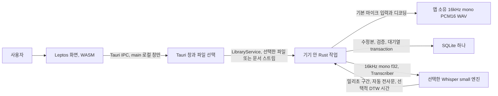

# seamone
기기에서 녹음하거나 가져온 음성을 받아쓰고, 음성과 글을 함께 확인하며 수정하는 Rust 앱이다. macOS, Windows, Linux, Android, iOS 설치 파일을 GitHub Actions에서 만든다. 실제 Whisper small 받아쓰기는 선택한 데스크톱 feature로 켠다.

## 1. 사용하는 흐름
1. 데스크톱에서 `녹음 시작`으로 기본 마이크를 열고 `멈추고 저장`을 누른다. 파일을 쓰려면 `음성 파일 가져오기`에서 WAV, MP3 또는 AAC-LC M4A를 고른다. 보관함에서는 저장한 음성이 바로 열린다. 다른 전사를 편집하거나 검수 중이라면 현재 화면을 유지하고 새 녹음을 보관함에 추가한다
2. Whisper 엔진이 포함된 설치본에서 `보관함 설정`의 `Whisper 모델 선택`으로 공식 `ggml-small.bin`을 고른 뒤 `기기 안에서 받아쓰기`를 누른다, 앱이 모델을 내려받지 않는다
3. `빠른 검수 시작`을 누르면 원본 음성이 끝까지 이어진다, 맞는 곳은 그대로 지나가고 오류를 알아챘을 때 `Space` 또는 `오류 표시`를 누른다
4. `앞 절반 듣기`와 `뒤 절반 듣기`로 같은 시간축의 원본 음성을 비교한다. `←`·`→`로 회색 후보를 고르고, `Enter`로 그 범위를 검은색으로 확정해 한 단계 더 좁힌다. `↑`로 오류를 빨간색으로 남겨 다른 갈래를 볼 수 있다
5. 빠른 검수의 `교정 목록 열기` 또는 저장한 글의 `오류와 수정본 교정 목록`에서 표시한 오류와 겹치는 원본 조각 전체를 듣고, 나온 말을 그대로 고친 뒤 `이대로 교정 확정`을 누른다, 중간에 멈추려면 `초안 저장`을 누른다
6. 저장한 글은 검증 여부와 관계없이 복사하거나 텍스트 파일로 내보낸다

[빠른 검수 키와 시간축 예시](project_manage/0005-2026_11_19-record_transcribe_edit/quick_review_design.md)에서 한 줄의 오류 두 곳을 함께 저장하는 흐름을 볼 수 있다. [녹음·받아쓰기·수정 화면 이슈](https://github.com/guny524/seamone/issues/5)에 첫 전사와 설치본 검증 순서가 있다.

- 첫 실행 안내에서 데스크톱 마이크를 바로 시작하거나 음성 파일을 고를 수 있다. 닫은 뒤에는 `개인정보와 학습 안내`로 다시 읽을 수 있다
- 다음 30초 음성을 준비하는 동안에도 Space로 마지막 재생 위치의 오류를 표시할 수 있다, 검수를 나간 뒤 준비와 취소가 끝날 때까지 다른 화면의 재생 버튼은 기다린다
- 빠른 검수에서 지나간 미확인 조각은 그대로 남으며 학습에서 제외한다, 짧은 무음과 줄 경계에서는 최대 2초 동안 앞서 들은 전사 줄도 보여 준다
- 좁은 창과 터치 환경의 빠른 검수에는 후보 선택과 듣기, 범위 좁히기, 보관 후 올라가기, 선택 취소, 저장 후 이어듣기 버튼이 표시된다
- 교정 화면에는 원본 음성의 전체 조각과 저장한 오류 위치, 자동 전사 원문과 수정 초안, 남은 조각을 표시한다. 확정하면 다음 조각으로 이동하며 새 조각을 들을 때까지 확정이 잠긴다
- 마이크는 macOS, Windows, Linux에서 쓴다. Android와 iOS에서는 파일을 가져올 수 있다. 기본 마이크가 없거나 접근이 거부되면 장치와 시스템 권한을 확인한 뒤 다시 시작한다
- 녹음은 최대 30분이며 제한에 도달하면 마이크를 해제한다. 장치가 끊기거나 앱을 닫으려 할 때 이미 받은 음성은 저장하거나 취소할 수 있다. 보관함 쓰기에 실패하면 같은 음성을 다시 저장할 수 있다. `녹음 취소`를 선택하면 받은 음성을 버린다
- 파일은 0초 초과 30분 이하, 최대 512MiB까지 받는다. WAV는 PCM 정수(8·16·24·32bit) 또는 32bit float를 지원한다. M4A는 AAC-LC를 지원한다. 지원하지 않는 인코딩, 읽을 수 없는 오디오 트랙, 확인된 손상에는 오류 이유를 표시한다
- 오류를 표시하면 앱은 runtime session을 일시 정지하고 반환된 원본 sample 위치를 읽는다, 앞선 전사 줄 시작점보다 최대 1초 앞에서 후보를 시작하되 이번에 실제로 재생한 최근 6초 안으로 제한한다
- 새 단계의 왼쪽 절반이 먼저 회색으로 표시된다. 각 절반이 4,000 samples(250ms) 이상일 때 나눈다. 더 나눌 수 없으면 현재 범위를 마지막 후보로 표시한다. 처음부터 나눌 수 없는 범위는 `Enter`로 선택한다
- `↑`로 올라가면 오류의 빨간 막대와 그 갈래에서 `Enter`로 고른 검은 막대가 남는다. 같은 갈래에서 한 번 더 올라가도 보관한 오류 범위를 넓히지 않는다
- `Backspace`는 현재 회색 후보를 버리고 한 단계 올라간다. 처음 단계에서 보관한 오류가 없으면 재생으로 돌아간다. 보관한 오류가 있으면 `Esc`로 그 범위만 저장할 수 있다
- 탐색 중 `Esc`를 누르면 고른 회색 후보와 보관한 빨간 오류를 함께 저장하고, `Space`를 누르던 재생 위치부터 이어간다. 처음 단계의 기본 회색은 직접 고른 경우에 저장한다. 저장이 실패하면 다시 `Esc`를 눌러 같은 요청을 재시도하거나 `Backspace`로 위치를 고칠 수 있다. 재생 중에는 `N`으로 다음 조각으로 넘어가거나 `Esc`로 검수를 나간다
- 빠른 검수의 가운데 시간축에 원본 음성 스펙토그램과 시각이 맞는 전사를 표시한다. 재생 중에는 현재 글을 강조하고, 오류 탐색 중에는 깊이별 범위 막대를 같은 축에 쌓는다. 저장한 오류는 시간축과 교정 대기에 표시한다. 시간축에서 잘린 글자는 아래의 전사 줄 전체에서 읽을 수 있다
- 조각과 겹치지 않는 오류는 보관함의 `표시한 오류 구간`에 원본 시간으로 표시한다, 겹치는 조각은 교정 목록에 추가한다
- 조각별 검증과 교정 화면에서 `Space`는 현재 조각 재생, `N`은 다음 조각, `Esc`는 나가기다, 조각별 검증에서 `1`은 Yes 판정이며 교정 확정은 `Ctrl/Command+Enter`로도 한다
- 처음 No로 판정한 글은 앞뒤 공백만 바꿔 교정 확정할 수 없다, 원래 글이 맞았다면 `처음 판정 취소하고 다시 검수`로 돌아가 다시 듣고 Yes를 고른다
- 오류 위치를 표시한 조각은 가장 최근에 오류를 표시할 때 저장된 글을 고쳐야 교정 확정할 수 있다, 초안을 따로 저장해도 비교하는 글은 유지한다, 앞뒤 공백만 바꾼 글은 확정할 수 없고 본문 안의 띄어쓰기를 고친 글은 조각 전체를 들은 뒤 확정할 수 있다
- 표시한 범위가 일부만 겹쳤거나 이 조각의 글이 맞았다면 `이 조각의 오류 판정 해제`를 누른다, 저장한 글과 원본 시간으로 기록한 오류 구간은 남고 학습 대기열에는 추가되지 않는다
- 잘 안 들리거나 잘린 구간은 확인하지 않고 남긴다, 재생할 수 없는 첫 조각도 건너뛰어 다음 조각을 확인할 수 있다
- 조각별 검증과 교정에서는 원본 조각 전체를 끝까지 재생한 뒤 확인할 수 있다, 저장이 실패하면 현재 조각에 남는다
- 일반 편집과 초안 저장은 정답을 만들지 않는다, 같은 글을 다시 저장하면 기존 검증을 유지한다
- 초안 저장으로 수정본이 바뀌면 다시 들어야 한다, 수정 목록에서 재생 후 편집하고 곧바로 확정하는 경우에는 한 번의 재생으로 충분하다
- 앱 내부 학습 엔진은 준비되지 않았다, 확인한 정답은 실제 로컬 대기열에 보관하며 학습 진행률을 표시하지 않는다
- 음성, 글, 검증 결과는 이 기기에 남는다, 외부 전송과 연합학습은 구현하지 않았다, 첫 실행 안내는 언제든 다시 연다

## 2. 구조

- `crates/seamone-core`: 음성 구간, 자동 전사문, 수정본, 실제 Yes/No 판정, 정답 snapshot, 학습 적격 조건과 검토 화면의 상태 전이, 화면과 native가 함께 쓴다
- `crates/seamone-asr`: 기존 `Transcriber` interface와 시험용 `FakeTranscriber`, `whisper` feature의 실제 엔진, 시험용 전사문은 제품 화면에 넣지 않는다
- `crates/seamone-runtime`: `LibraryService`가 CPAL 마이크, 입력 디코딩, WAV 보관, SQLite migration, 받아쓰기, 재생 증거, 검수 저장과 학습 대기열을 소유한다, Store와 raw mutate는 crate 밖에 공개하지 않아 host가 Store를 직접 바꿀 수 없다
- runtime의 비공개 `playback_evidence`는 현재 조각과 revision의 음성을 준비하고 `player`에 한 session을 둔다, 비공개 `output`의 Renderer가 CPAL callback의 장치 시계로 출력 완료를 확인한 범위만 `PlayedRun`으로 보내고 `Heard`가 합집합을 만든다, 조각 전체를 덮은 session만 `AuthorizedReview`를 발급한다, `Store::mutate`는 이 승인 값의 불변 요청만 저장한다, Yes와 No 판정 및 교정 확정은 이 증거를 요구하며 초안 저장과 오류 표시 해제, 검증 취소는 재생 없이 승인한다
- `VerifiedText`의 필드는 core의 검수 전이 밖에서 직접 조립하지 못하고 getter로 읽는다. DB와 IPC의 JSON 모양을 유지하기 위해 Deserialize는 남긴다. 따라서 타입의 필드 비공개만으로 저장 권한을 보장하지 않으며 Store의 확인 전사 쓰기와 학습 대기열 삽입 위치도 검사한다
- `app/src-tauri`: 신뢰할 창과 command 권한, 파일 dialog, mobile 문서 URI 접근과 해제, clipboard와 Tauri 이벤트를 맡고 `LibraryService`를 호출한다, Android의 seek할 수 없는 문서 스트림은 runtime이 크기를 제한해 임시 파일로 옮긴 뒤 디코딩한다
- `app/ui`: 빠른 검수, 조각별 검증, 교정, 일반 편집 화면, 빠른 검수와 검증·교정은 runtime의 재생 상태를 조회한다, 빠른 검수는 preview session으로 원본을 최대 30초씩 이어 재생하며 확인 전사를 만드는 증거는 발급받지 않는다
- `research`: 앱과 별도인 PyTorch 연구 코드, 앱은 Python을 포함하지 않고 연구 adapter를 활성화하지 않는다
- research의 직접 삭제 API는 `seamone_research/cache.py`의 `remove_inside`에 모은다. 이 함수는 HF_HOME 아래 전용 eval-raw/seamone_eval cache 안에서 root의 자식만 삭제하고 공유 HF_HOME/hub와 root 밖의 symlink를 거절한다. manifest 파일 삭제는 기존 missing_ok 동작을 유지한다
- UI는 HTML audio·video node와 media API로 소리를 내지 않는다, UI Cargo의 HtmlAudioElement·HtmlMediaElement feature를 제거했으며 Cargo 경계 검사가 별칭·platform·optional feature 전달의 재도입을 거절한다, Leptos의 tachys가 media binding을 간접 활성화하므로 타입 자체가 compiler에서 사라지지는 않는다, 구조 검사는 제품 UI Rust와 index.html의 media 타입·tag, audio/video literal, data:audio/data:video URL과 명시적인 media JavaScript도 거절하며 iframe·embed·object도 허용하지 않는다, 임의의 동적 JavaScript를 격리하는 sandbox는 아니다
- 재생 확인은 1배속 출력 callback에 제출한 모든 source sample의 버퍼 끝이 장치 시계를 지난 상태다, 일시 정지와 되감기, 앞으로 넘긴 뒤 빈 구간을 다시 듣는 것을 허용한다, macOS의 device, stream 지연과 safety offset, Windows의 stream 지연과 장치 period를 CPAL의 playback 시각에 더하며 ALSA는 CPAL이 읽은 get_delay를 쓴다, 지연 조회 실패와 장치 오류, 잘못된 시각은 session 전체를 무효로 하며 처음부터 다시 열어야 한다, OS mute나 실제 사람의 청취는 확인할 수 없다, 앱에 별도 음량 조절은 없다

### 2-1. 데이터와 저장
- native가 앱 데이터 폴더의 `seamone.sqlite3`와 `audio/<UUID>.wav`를 소유한다, 화면에서 임의 파일 경로를 넘겨 읽을 수 없다
- 마이크와 파일은 채널을 평균해 mono로 합치고 8–192kHz 입력을 저역통과한 뒤 16kHz PCM16 WAV로 저장한다. 16kHz mono PCM16 WAV의 샘플 값은 그대로 복사한다. MP3와 AAC-LC M4A는 Symphonia로 디코딩한다
- 녹음 thread가 CPAL Stream을 열고 닫는다. 입력 callback은 크기가 고정된 queue에 샘플을 보내고, thread는 이를 앱 소유의 임시 WAV에 기록한다. 녹음 또는 파일 디코딩·저장 동안 기존 학습 foreground gate를 공유한다
- 보관함은 완성된 WAV와 SHA-256을 기록한 뒤 SQLite에 녹음 정보를 추가한다. SQLite 저장이 실패하면 보관함에 새로 만든 WAV를 정리한다. 스키마는 기존 녹음과 검수 기록을 그대로 읽는다
- 녹음마다 엔진과 모델 metadata를 보관한다, 자동 전사문과 사용자가 편집한 글은 별도 칸이다
- native는 `Transcriber`가 반환한 줄의 밀리초 범위를 16kHz 원본 샘플 범위로 변환한다. Whisper small의 DTW token 시각은 실제 디코딩된 텍스트와 일치하고 줄 범위 안에서 순서가 맞을 때 함께 저장한다
- 여러 글자로 된 token, UTF-8이 나뉜 token, grapheme에 걸친 token은 확인 가능한 시간 범위를 공유한다. 타이밍이 없는 기존 데이터나 사람이 수정한 글은 전사 줄 전체의 범위로 표시한다
- 재생은 파일에서 해당 구간만 seek해 읽는다, 시작을 포함하고 끝을 제외하는 최대 60초 WAV를 만들어 제한된 IPC 응답으로 보낸다
- `get_recording_playback`은 녹음 ID, 녹음 revision, 원본 표본 범위를 받아 WAV를 돌려준다, 빠른 검수의 스펙트로그램 분석에 쓰며 소리를 내거나 학습에 필요한 재생 증명을 발급받지 않는다
- 빠른 검수의 `save_error_marks`는 요청 ID, 녹음 ID와 revision, 여러 원본 샘플 범위를 받는다. 이번 요청의 샘플 범위와 겹치는 조각을 한 SQLite transaction에서 교정 대상으로 바꾸고 기존 학습 자격을 거둔다. 앞서 기록한 샘플을 새 요청으로 다시 표시해도 다시 교정 대상으로 올린다. 이미 표시한 샘플은 중복 저장하지 않으며, 같은 요청 ID와 내용으로 재전송하면 처음 저장한 결과를 유지한다
- 기존 단일 범위 저장 명령 `save_error_mark`와 페이지 조회 명령 `get_error_marks`도 쓸 수 있다. 오류 범위를 저장할 때 조각의 원본 시간, 자동 전사문, 편집한 글, 기존 Yes/No 판정을 보존한다
- 조각 목록은 한 응답에 최대 32개, 각 글은 최대 32KB, 녹음 전체의 편집 글은 최대 2MB다
- 검증 요청은 event ID, 조각 ID, 정확한 revision, 동작을 담는다, 같은 event의 재전송은 같은 결과를 돌려주며 다른 내용이나 오래된 revision은 오류다
- 화면과 Tauri는 `save_review`의 요청·응답 타입을 공용 명령 목록에서 가져온다. JSON 최상위의 `request`와 선택 필드 `proof`를 받아 `Segment`를 반환한다
- 화면에서 Tauri를 부르는 모든 명령의 이름·요청·응답 타입은 `seamone-core::ipc`의 명령 목록에 한 번 등록한다. 화면의 호출 함수는 등록된 명령 타입만 받고, Tauri 등록과 창·플랫폼 권한 검사도 같은 목록을 쓴다
- 변경은 짧은 SQLite transaction에서 revision을 비교한 뒤 저장한다, 정답 snapshot과 대기열도 함께 저장해 일부만 남지 않는다
- 자동 글을 그대로 맞다고 한 정답과 수정 후 확인한 정답은 출처를 구분한다, 편집이나 검증 취소는 그 수정본의 정답과 대기열을 무효화한다
- 학습 시작과 결과 공개 직전에 현재 수정본, 녹음 revision, 원본 존재와 SHA-256을 다시 검사한다, 원본 읽기 실패는 복구 뒤 재시도하며 바뀐 수정본은 제외한다
- 대기열 claim은 소유자와 5분 lease를 사용한다, 보관함을 다른 연결로 열었다는 이유로 진행 중인 claim을 되돌리지 않는다, 만료한 claim만 회복한다
- native optimizer를 연결할 경계는 있지만 현재 설치본은 대기열을 처리하지 않는다, 모델 activation과 네트워크 FL도 하지 않는다

### 2-2. 음성 입력 IPC

- 앱에 포함된 `main` 창의 로컬 화면에서만 아래 명령을 쓴다. 화면은 파일 경로나 음성 버퍼를 보내지 않는다
- `import_audio({})`는 native 파일 선택기를 연다. 선택을 취소하면 `null`, 저장하면 기존 `RecordingInfo`를 반환한다
- `get_capture_status({})`는 `state`로 상태를 반환한다. 모바일은 `unavailable`이다. 데스크톱은 `idle`, `starting`, `recording`, `limit_reached`, `interrupted`, `finishing`, `failed` 중 하나다. 진행 중인 세션에는 `session_id`가 있고, 녹음 중과 중단 상태에는 `elapsed_seconds`가 있다. 중단은 `reason`, 시작이나 복구가 불가능한 오류는 `message`를 함께 반환한다
- 데스크톱의 `start_recording({})`은 세션을 만들고 현재 상태를 반환한다. `finish_recording({ sessionId, save })`는 해당 세션을 마무리한다. `save: true`면 `RecordingInfo`, `save: false`면 `null`을 반환한다. 동시에 하나만 녹음할 수 있고 이전 세션의 종료 요청은 거절한다. 저장에 실패해도 완성된 음성을 같은 세션에서 다시 저장하거나 취소할 수 있다

### 2-3. 음성 출력 IPC
- 조각과 녹음의 재생 준비, 재생 제어, 상태 조회에 쓰는 다섯 명령은 공용 명령 목록에서 요청과 응답 타입을 정한다. 화면의 공개 호출 함수는 이 명령에 공용 타입만 받는다
- 아래 명령은 `main` 로컬 창에서만 쓴다, 모든 위치는 녹음 원본의 16kHz sample 절대 위치이고 범위는 시작 포함, 끝 제외다
- `get_playback({ segmentId, revision })`은 현재 조각 전체의 WAV와 `session`, `segment_id`, `revision`을 반환한다, 아직 재생하지 않으며 이전 session과 증거를 버린다
- `play_recording({ recordingId, revision, range })`은 검수 증거를 만들지 않는 미리 듣기를 시작하고 Status를 반환한다, 이전 session은 닫는다, 빠른 검수의 30초 연속 재생과 절반 듣기가 이 명령을 쓴다
- `control_playback({ session, action })`은 `action.kind`의 `play`, `pause`, `seek`, `stop`을 받고 Status를 반환한다, `seek`는 절대 위치 `at`을 함께 받으며 현재 구간 밖을 거절한다, `stop`은 장치를 닫고 확인된 범위를 유지해 다시 `play`할 수 있게 한다, 다른 session의 조작은 거절한다
- `get_playback_status({})`는 `session`, `state`, `position`, `heard`, `error`를 반환한다, state는 `idle`, `ready`, `playing`, `paused`, `finished`, `failed`다, 끝 위치여도 건너뛴 구간이 남으면 heard는 false다, UI가 보내는 완료 명령은 없다
- 데스크톱의 출력 thread가 CPAL stream을 소유한다, 출력 callback은 미리 준비한 음성과 고정 크기 queue를 쓰고 lock과 할당을 하지 않는다, 장치 buffer 시각이 거꾸로 가거나 playback 시각이 callback보다 앞이면 오류다, 벽시계를 기다려 증거를 만들지 않는다
- Android와 iOS에는 같은 IPC와 출력 trait가 있으며 음성 출력을 요청하면 `이 기기에서는 아직 재생을 지원하지 않습니다`를 반환한다, 장치 지원은 뒤 구현에서 더한다

## 3. 실행과 검증
### 3-1. 준비
- 구조 검사는 Python 3.11 이상을 사용한다, CI는 Python 3.12에서 Cargo/Ruff의 TOML lint 설정까지 검사한다
- `rustup`을 설치한 뒤 레포 맨 위에서 `make install`을 실행한다, `rust-toolchain.toml`의 Rust와 고정한 tauri-cli, Trunk를 설치한다
- 로컬 데스크톱 실행에는 해당 OS의 Tauri 개발 환경이 필요하다, 설치 파일은 로컬에서 만들지 않는다
- Linux 빌드에는 ALSA 개발 패키지(`libasound2-dev`)가 필요하다. macOS는 `Info.plist`의 마이크 사용 목적을 표시하고 처음 녹음할 때 시스템 권한을 요청한다
- 기본 실행은 `make dev`다, 기본 feature에는 실제 ASR 엔진이 없으므로 받아쓰기 버튼이 엔진을 포함한 설치본을 안내한다

### 3-2. offline Whisper small
공식 모델은 [고정한 whisper.cpp 모델 저장소](https://huggingface.co/ggerganov/whisper.cpp/tree/80da2d8bfee42b0e836fc3a9890373e5defc00a6)의 `ggml-small.bin`이다.
- SHA-256은 `1be3a9b2063867b937e64e2ec7483364a79917e157fa98c5d94b5c1fffea987b`다, 선택할 때와 엔진이 불러올 때 확인한다
- 모델은 별도로 준비해 파일 선택 대화상자에서 지정한다, 모델이 없거나 다르면 앱이 고칠 방법을 안내하며 시작할 때 내려받지 않는다
- 실제 데스크톱 엔진 실행 명령은 `make dev CARGO_FEATURES=desktop-whisper`다, 현재 엔진은 CPU 경로를 쓴다
- macOS Command Line Tools에서 C++ `<array>` header를 찾지 못하면 설치된 SDK의 header를 이 명령에만 지정한다
```sh
CXXFLAGS="-isystem $(xcrun --sdk macosx --show-sdk-path)/usr/include/c++/v1" make dev CARGO_FEATURES=desktop-whisper
```
- 모델 파일은 가져온 음성과 별도다, 이 연구의 PyTorch LoRA adapter는 GGML 엔진에서 불러오지 않는다

### 3-3. 시험 범위
- `make check-architecture`는 앱을 빌드하지 않고 Cargo가 읽은 직접 의존성과 검사기의 부정 사례를 확인한다. host는 core와 runtime, runtime은 core와 ASR만 참조한다. SQLite와 마이크, 디코더는 runtime, Tauri는 host, Whisper는 ASR, Leptos는 UI에서 사용한다. UI의 hound는 IPC로 받은 재생 WAV를 읽는 데 쓴다. 데스크톱과 모바일 패키지 빌드도 같은 의존성 검사를 먼저 실행한다. host의 normal 의존은 core, runtime, serde, serde_json, Tauri와 Tauri plugin으로 제한한다. runtime의 공개 선언은 `scripts/runtime_api.json`과 대조하며 목록에 더하기 전에 LibraryService의 증거 확인 경로를 거치는지 검토한다. 새 workspace crate를 추가할 때는 `scripts/check_crate_boundaries.py`에 허용 방향을 지정한다
- 화면의 공용 호출 함수가 Tauri의 비공개 binding을 사용한다. `make check-imports`는 이 binding과 공용 호출 함수가 든 `app/ui/src/api/tauri.rs`의 해시를 대조한다. 나머지 `src/`의 Rust 이름과 문자열, Trunk 시작 HTML의 속성과 인라인 스크립트에 직접 쓰인 `__TAURI__`와 `__TAURI_INTERNALS__`를 검사한다. 브라우저 시험의 Tauri 대역은 `app/ui/tests/`에서 제공한다
- 제품 UI의 Cargo 타깃은 `src/`에서 시작한다. 검사 범위를 건너뛰는 Rust 모듈 로딩을 막기 위해 UI의 Cargo build script, 직접 쓴 `include!`와 그 별칭, 모듈 경로 속성과 소스 symlink를 거절한다. 속성의 대괄호 안에 들어간 매크로 변수와 `$name!(...)` 형태의 호출도 검사한다
- 저장소의 Trunk 설정은 UI의 `index.html`을 읽고 같은 디렉터리의 `dist/`에 빌드한다. `make check-imports`는 시작 HTML의 해시를 대조해 인접한 `Cargo.toml`을 고르는 Rust 링크와 Trunk 스타일시트 링크를 고정한다. Makefile의 빌드·개발 명령과 모바일 CI는 `TAURI_APP_PATH`로 검사한 `app/src-tauri`를 선택한다. Trunk build hook과 Tauri overlay의 프런트엔드 build 설정은 거절하며, overlay 이름은 대소문자를 구분하지 않고 비교한다. macOS 패키지의 최소 버전 같은 번들 설정은 별도 JSON overlay로 둔다
- `make check-domain`은 운영체제 표준 라이브러리가 없는 타깃에서 도메인 crate를 단독으로 컴파일한다. CI가 `rustup target add wasm32v1-none`으로 타깃을 준비한다
- `make lint-ios`는 macOS CI에서 host와 runtime의 iOS simulator 전용 코드를 Clippy로 컴파일한다. CI가 `aarch64-apple-ios-sim` 타깃을 준비하며 이 명령은 타깃을 설치하거나 앱을 패키징하지 않는다
- 새 Cargo member는 workspace lint를 전부 상속해야 한다. 기존 Clippy 필수 명령은 유지하고 추가한 명령도 `-D warnings`를 쓴다
- `make test-runtime-doc`는 host의 test-support feature 없이 runtime doctest만 검증하며 CI에서도 workspace 시험과 별도 step으로 실행한다
- `make lint`는 정책 검사(`make check-lint-policy`)와 Rust 서식, native/WASM Clippy, UI 시험 JavaScript 구문(`make lint-code`)을 각각 실행한다. `lint-code`는 `lint-runtime-minimal`, `lint-format`, `lint-workspace-code`, `lint-wasm-code`를 `make -k`로 나눠 실행해 앞 컴파일이 실패해도 뒤 컴파일 진단을 확인한다. `lint-runtime-minimal`은 test-support와 Whisper 없이 runtime 제품 라이브러리를 컴파일해 시험 feature가 죽은 코드를 가리지 못하게 하며 Linux와 macOS CI에서도 별도 step으로 실행한다. 정책이 실패해도 컴파일은 실행하고 둘 중 하나라도 실패하면 전체가 실패한다. `make lint-native`와 `make lint-ios`도 같은 방식으로 정책 검사와 `lint-native-code`, `lint-ios-code`를 실행한다. CI도 구조 검사와 컴파일을 별도 step으로 나누며 취소하지 않은 실행에서는 정책 실패 뒤에도 컴파일과 Rust 시험을 진행한다
- lint 예외는 없다. `scripts/lint_exceptions.json`의 `existing`은 비어 있으며 Rust `allow`/`expect`, Python `noqa`/`type: ignore`, Cargo와 Ruff의 억제를 추가하면 `make check-lint-exceptions`가 거절한다. `missing_errors_doc`, `missing_panics_doc`, `module_name_repetitions`를 켜서 공개 오류와 panic의 설명, module 안 이름도 검사한다. 수치 변환은 범위가 정해진 값과 명시적 변환으로 나타낸다
- lint 설정은 `LINT_BASE_REF`(기본 `origin/develop`)와 비교한다. Cargo의 문서와 이름 lint를 켜거나 Ruff lint의 ignore를 줄이는 변경만 허용하며 다른 설정 표, 임계값과 필수 Clippy 명령은 유지한다. Ruff의 lint 밖 표 전체도 기준과 대조하고 `extend`로 다른 설정 파일을 불러오는 것은 거절한다. research Makefile의 Ruff 실행 명령은 기준과 대조해 검사 대상과 서식 검사를 줄이지 못하게 한다. 별도 clippy/Ruff 설정, Cargo rustflags의 `-A`와 `--cap-lints`, Clippy 명령의 억제와 `-D warnings` 삭제를 거절한다. 기준 ref나 JSON이 없으면 실패한다
- Rust 일반 주석과 Python 주석은 외부 API, 플랫폼과 파일 형식처럼 이 코드에서 바꿀 수 없는 사정만 남긴다. 설명은 이름과 구조로, 지켜야 할 제약은 타입과 검사와 행동 시험으로 나타낸다. `make check-comments`는 남은 주석의 경로와 원문, 원문의 SHA-256을 `scripts/comments.json` 및 기준 ref와 대조해 새 주석, 본문 수정, 복제와 목록 추가를 거절한다. 문서 주석(`///`, `//!`, 문서 block 주석), docstring, shebang과 encoding 선언은 제외하고 docstring 이외의 Python 문자열 문장과 bytes 문장, f-string은 주석처럼 거절한다. AVFoundation의 `// SAFETY:`도 외부 API의 안전 조건으로 고정한다. Makefile, YAML, TOML과 shell 주석은 이 검사의 범위가 아니다. `make lint`와 `make check-architecture`도 같은 검사를 실행한다
- UI가 호출할 Tauri 명령 이름은 `crates/seamone-core/src/ipc.rs`에 선언한다. 같은 선언이 UI 명령 타입, native 처리 함수 등록, 빌드 시 권한 이름을 만든다. 새 명령은 허용할 창과 플랫폼의 capability에도 추가해야 권한 시험을 통과한다
- `make test`: runtime에서 합성 녹음 수명과 저장 복구, WAV·MP3·M4A 변환, 실제 SQLite 저장과 검수 증거를 확인한다. public 서비스와 비공개 저장소의 통과/컴파일 거절 doctest도 실행한다. host는 dev 의존에서만 켜는 runtime `test-support`로 보관함을 준비하고 등록 IPC로 재생 완료, 검수 저장과 내보내기, 오류 위치, 녹음 상태의 JSON과 창 닫기 차단을 확인한다. host의 const assert는 녹음 지원 플랫폼을 제품 컴파일에서도 대조한다. fixture는 runtime에 두며 실제 마이크나 OS 파일 선택기는 열지 않는다. `make test CARGO_FEATURES=desktop-whisper`는 host feature만 켜서 runtime 엔진까지 전달되는지도 확인한다
- 같은 crate 안의 증거 경계도 `make test`로 확인한다, 실제 Store와 증거 모듈 소스를 함께 컴파일하는 compile_fail 예제마다 금지 줄 하나를 허용 호출로 바꾼 정상 짝을 둔다, 증거 없는 저장 호출, 증거와 승인 값의 직접 생성, Default 생성 및 output 밖의 PlayedRun·Heard 생성을 거절한다, 오류 번호는 예상 번호이며 rustdoc이 번호 자체를 검증하지는 않는다, `scripts/playback_api.json`은 노출 선언, trait 구현, derive와 생산 코드의 token hash를 고정한다, cfg(test) 모듈의 시험 본문은 hash에서 뺀다, 호출 위치 검사와 실시간 callback의 lock·할당 거절 검사도 실행하며 해시 변경은 base 대조와 사람 검토를 거친다
- `make check-research-deletions`는 research 소스와 시험의 직접 삭제, HF cache 삭제, 경로 이름 변경과 Make recipe의 rm을 확인한다. 삭제는 cache.remove_inside, 같은 폴더의 일반 .part 파일 공개는 cache.publish_partial에서만 한다. 타입을 모르는 값도 위치 인자가 하나인 replace는 경로 교체로 거절하고, old/new 두 인자를 주는 문자열 replace는 허용한다. builtins의 동적 getattr도 거절한다. eval/exec/compile은 거절한다. subprocess와 os 실행 명령은 현재 쓰는 곳이 없어 모두 거절하며, git/ffmpeg 같은 실행을 허용할지는 사람이 정할 정책으로 남긴다. path와 공유 hub 보존, symlink 거절은 행동 시험으로 확인한다. 임의의 외부 라이브러리 부작용을 모두 분석하는 sandbox는 아니다
- `make check-unsafe`는 unsafe를 파일 전체가 아닌 `scripts/unsafe_files.json`의 함수 이름과 본문 해시로 제한한다. 마이크 권한 함수와 macOS, Windows의 출력 지연 조회 함수 외의 unsafe, capture의 저장소·증거·transmute 접근, runtime의 include!를 거절한다. 허용 항목의 변경은 PR base와 대조하고 사람이 먼저 확인해야 한다
- `make check-review-writes`는 보호 SQL을 비공개 WritePermit의 고정 저장 메서드로 모으고, 저장 전용 module의 타입·권한·구현을 base의 해시와 대조한다. cfg(test) module 안의 시험 본문은 이 해시에서 뺀다. 호출자에게 열린 permit을 돌려주지 않으며, 메서드 안에서 실제 저장값을 검사하고 직렬화한다. 검수 저장은 DB의 현재 값과 승인된 요청의 core 전이를 대조하고, 새 확인 전사에는 Played 승인을 요구한다. SQLite authorizer는 메서드 밖의 보호 쓰기, training_queue 대상·revision 열 UPDATE, trigger를 통한 보호 쓰기를 거절한다. 정적 검사는 SQL 인자의 리터럴 전체를 EXPLAIN하고, prepare*로 만든 Statement의 실행 인자는 데이터로 구분한다. 동적 SQL과 메서드 참조, Batch/raw API와 외부 소스 경로(cfg_attr 포함)를 막고, 시험 외의 Connection::open*은 Store::open으로 제한한다. authorizer/hooks 변경도 Store::open과 저장 module로 제한하며, migration 뒤 DDL과 writable_schema를 거절한다. migration 경로와 내용 해시도 base와 대조한다. 임의의 외부 프로그램까지 막는 sandbox는 아니다
- `scripts/runtime_api.json`, `scripts/playback_api.json`, `scripts/review_writes.json`, `scripts/unsafe_files.json`, `scripts/comments.json`은 `LINT_BASE_REF`의 같은 목록과 비교한다. base에 목록이 없거나 현재 목록의 항목과 개수가 늘면 실패한다. 사람이 확인한 뒤에만 기준 브랜치의 목록을 늘리며, 이 PR의 CI는 사람이 보고 판단한다. 이슈 브랜치에서 목록을 함께 고쳐 검사 통과를 승인할 수 없다
- CI의 기준 선택은 guard-base reusable workflow 한 곳에서 한다. PR은 base SHA, develop push는 첫 parent를 비교 기준으로 쓰고, 다른 브랜치 push는 origin/develop과의 merge-base를 쓴다. develop의 검사 정책은 이미 승인된 HEAD에서 읽으므로 merge한 목록·module 해시를 다시 거절하지 않는다. tag push에는 검사를 실행하지 않는다. base가 HEAD와 같은 PR은 거절하고 비교할 변경이 없는 branch push와 로컬 검사는 허용한다. guard-integrity는 base의 검사 코드와 목록으로 PR merge ref를 검사하므로 뒤처진 PR에 base가 승인한 변경도 포함한다. head의 검사 helper와 Make target은 실행하지 않는다. 보호 파일 변경은 별도 guard-review-trusted workflow의 pull_request_target job `guard-rules-review-trusted`가 merge-base부터 PR head까지 판정한다. 필수 check는 이 이름으로 지정하며 branch protection 설정은 레포 밖에서 관리한다. scripts, Makefile, research/Makefile, .github, AGENTS.md, .cargo, rust-toolchain.toml과 모든 crate의 lint 표가 보호 대상이다. trusted job은 head 코드를 실행하지 않는다. 검사 자체를 바꾸는 PR의 실패를 없애는 예외는 두지 않는다
- `make test-ui-state`는 native에서 빠른 검수의 준비 중 Space, 화면 전환 때 재생 차단과 실패 위치 보존을 확인한다, 시험 executor는 실제 IPC future를 실행하지 않고 상태 전이만 확인한다, `make test-ui-fixture`는 브라우저 없이 Node로 command가 callback 전에 ready/playing을 반환하는 것과 preview의 검수 권한 거절을 확인하며 `make test`에도 포함된다
- `make ui-test`: 실제 WASM 화면을 Chrome에서 실행해 첫 실행, 녹음과 파일 가져오기, 키보드와 터치 오류 탐색, 원본 PCM 스펙트로그램과 미리 듣기의 샘플 위치를 확인한다, 빠른 검수의 chunk 전환과 늦은 준비 취소, 교정 화면의 확인은 runtime 상태 조회로 시험하며 준비 중 오류 표시와 다른 화면의 재생 대기, 오래된 session의 stop을 확인한다, 앱의 IPC 서비스와 출력 진행은 시험용이다, 다운로드 페이지의 화면과 빌드 링크도 확인한다
- `make site-preview`: [다운로드 안내](site/index.html)를 로컬 `http://127.0.0.1:4173`에서 열어 본다. 포트가 쓰이는 중이면 `make site-preview SITE_PORT=4174`로 바꾼다
- macOS 패키지 CI는 업로드할 DMG를 읽기 전용으로 열어 체크섬, 앱 식별자, CPU 종류와 마이크 권한 안내를 검사한다. Whisper 빌드에서는 Mach-O와 Info.plist의 최소 macOS 버전을 빌드 설정과 대조한다
- `CARGO_BUILD_JOBS=2 make playback-device-proof`: 기본 출력 장치로 1초의 작은 400Hz tone을 내고 장치 시계와 들은 범위를 확인한다, 기본 시험에서는 ignored이며 실제 장치가 있는 macOS·Windows·Linux에서 사람이 별도로 실행한다, 소리가 나므로 자동 CI와 worker에서는 실행하지 않는다
- `make desktop-proof`: 실제 Whisper small과 공개 음성 파일로 가져오기, 받아쓰기와 DTW 시간 저장, 짧은 구간 듣기, 오류 위치 저장, 전체 조각 교정 확인, 학습 자격과 다시 열기를 확인한다. 시험에서 학습은 실행하지 않는다
- `make -C research test`: 연구 규칙과 optimizer 계산의 회귀시험, 실제 모델 optimizer 증명은 별도 `verified-step` target이다
- `make fmt`와 `make -C research fmt`: 소스 형식을 맞춘다

UI 시험 의존성은 시험 폴더에만 설치한다, 기존 Chrome을 사용하면 브라우저를 따로 내려받지 않는다.
```sh
npm ci --prefix app/ui/tests --ignore-scripts --no-audit --no-fund
SEAMONE_CHROME="/Applications/Google Chrome.app/Contents/MacOS/Google Chrome" make ui-test
```
Linux에서는 `SEAMONE_CHROME="$(command -v google-chrome)" make ui-test`를 쓴다.

실제 native 모델 시험은 준비한 파일 경로를 지정한다.
```sh
SEAMONE_WHISPER_MODEL=/path/to/ggml-small.bin SEAMONE_TEST_WAV=/path/to/public-ko.wav make desktop-proof
```
`SEAMONE_TEST_WAV`에는 공개 한국어 WAV, MP3 또는 AAC-LC M4A 파일을 지정할 수 있다. macOS에서 위 C++ header 오류가 나면 같은 `CXXFLAGS`를 이 명령에도 지정한다. `CARGO_TARGET_DIR`을 지정하면 각 make target이 같은 Cargo cache를 쓴다.

### 3-4. CI 설치 파일
- `.github/workflows/ci.yml`은 `make lint`, `make test`, `make ui-test`, `make -C research test`를 실행한다, UI 시험은 runner에 설치된 Chrome/Chromium을 찾고 없으면 실패한다
- `.github/workflows/build.yml`은 macOS arm64와 x86_64 dmg, Windows exe와 msi, Linux deb와 AppImage, Android debug apk, iOS simulator app을 만든다
- 기본 다섯 플랫폼 빌드는 유지한다, Actions의 build를 수동 실행할 때 `desktop-whisper`를 선택하면 데스크톱 설치본에만 실제 엔진을 포함한다, 모델 파일은 포함하지 않는다
- Whisper를 포함한 macOS 설치본만 macOS 11.0 이상을 요구한다, CI가 전용 config를 병합하면 Tauri CLI가 컴파일 deployment target과 bundle 최소 version에 함께 적용한다
- desktop의 `make build`와 모바일의 기존 Tauri build 명령은 CI에서만 실행한다, 서명과 앱 장터 배포는 포함하지 않는다
- Actions 실행의 Artifacts에서 설치 파일을 받는다, Android 시험용 debug 키는 `.github/android/debug.keystore`로 고정한다
- macOS와 Windows 설치 파일은 인증서로 서명하지 않았다, macOS는 `xattr -dr com.apple.quarantine seamone.app` 뒤에 열고 Windows는 SmartScreen의 추가 정보, 실행을 누른다
- Linux AppImage는 실행 권한을 준 뒤 연다, Android는 시험용 debug 서명 APK이며 iOS는 시뮬레이터용이다

## 4. 라이선스
Apache-2.0, 모델과 공개 corpus의 이용 조건은 각각의 배포처에서 확인한다.
