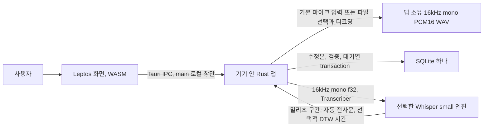

# seamone
기기에서 녹음하거나 가져온 음성을 받아쓰고, 음성과 글을 함께 확인하며 수정하는 Rust 앱이다. macOS, Windows, Linux, Android, iOS 설치 파일을 GitHub Actions에서 만든다. 실제 Whisper small 받아쓰기는 선택한 데스크톱 feature로 켠다.

## 1. 사용하는 흐름
1. 데스크톱에서 `녹음 시작`으로 기본 마이크를 열고 `멈추고 저장`을 누른다. 파일을 쓰려면 `음성 파일 가져오기`에서 WAV, MP3 또는 AAC-LC M4A를 고른다. 보관함에서는 저장한 음성이 바로 열린다. 다른 전사를 편집하거나 검수 중이라면 현재 화면을 유지하고 새 녹음을 보관함에 추가한다
2. Whisper 엔진이 포함된 설치본에서 `보관함 설정`의 `Whisper 모델 선택`으로 공식 `ggml-small.bin`을 고른 뒤 `기기 안에서 받아쓰기`를 누른다, 앱이 모델을 내려받지 않는다
3. `빠른 검수 시작`을 누르면 원본 음성이 끝까지 이어진다, 맞는 곳은 그대로 지나가고 오류를 알아챘을 때 `Space` 또는 `오류 표시`를 누른다
4. `앞 절반 듣기`와 `뒤 절반 듣기`로 같은 시간축의 원본 음성을 비교한다. `←`·`→`로 회색 후보를 고르고, `Enter`로 그 범위를 검은색으로 확정해 한 단계 더 좁힌다. `↑`로 오류를 빨간색으로 남겨 다른 갈래를 볼 수 있다
5. 빠른 검수의 `교정 목록 열기` 또는 저장한 글의 `오류와 수정본 교정 목록`에서 표시한 오류와 겹치는 원본 조각 전체를 듣고, 나온 말을 그대로 고친 뒤 `이대로 교정 확정`을 누른다, 중간에 멈추려면 `초안 저장`을 누른다
6. 저장한 글은 검증 여부와 관계없이 복사하거나 텍스트 파일로 내보낸다

- 첫 실행 안내에서 데스크톱 마이크를 바로 시작하거나 음성 파일을 고를 수 있다. 닫은 뒤에는 `개인정보와 학습 안내`로 다시 읽을 수 있다
- 빠른 검수에서 지나간 미확인 조각은 그대로 남으며 학습에서 제외한다, 짧은 무음과 줄 경계에서는 최대 2초 동안 앞서 들은 전사 줄도 보여 준다
- 좁은 창과 터치 환경의 빠른 검수에는 후보 선택과 듣기, 범위 좁히기, 보관 후 올라가기, 선택 취소, 저장 후 이어듣기 버튼이 표시된다
- 교정 화면에는 원본 음성의 전체 조각과 저장한 오류 위치, 자동 전사 원문과 수정 초안, 남은 조각을 표시한다. 확정하면 다음 조각으로 이동하며 새 조각을 들을 때까지 확정이 잠긴다
- 마이크는 macOS, Windows, Linux에서 쓴다. Android와 iOS에서는 파일을 가져올 수 있다. 기본 마이크가 없거나 접근이 거부되면 장치와 시스템 권한을 확인한 뒤 다시 시작한다
- 녹음은 최대 30분이며 제한에 도달하면 마이크를 해제한다. 장치가 끊기거나 앱을 닫으려 할 때 이미 받은 음성은 저장하거나 취소할 수 있다. 보관함 쓰기에 실패하면 같은 음성을 다시 저장할 수 있다. `녹음 취소`를 선택하면 받은 음성을 버린다
- 파일은 0초 초과 30분 이하, 최대 512MiB까지 받는다. WAV는 PCM 정수(8·16·24·32bit) 또는 32bit float를 지원한다. M4A는 AAC-LC를 지원한다. 지원하지 않는 인코딩, 읽을 수 없는 오디오 트랙, 확인된 손상에는 오류 이유를 표시한다
- 오류를 표시하면 앱은 누르는 순간의 재생 위치를 읽는다, 앞선 전사 줄 시작점보다 최대 1초 앞에서 후보를 시작하되 이번에 실제로 재생한 최근 6초 안으로 제한한다
- 새 단계의 왼쪽 절반이 먼저 회색으로 표시된다. 각 절반이 4,000 samples(250ms) 이상일 때 나눈다. 더 나눌 수 없으면 현재 범위를 마지막 후보로 표시한다. 처음부터 나눌 수 없는 범위는 `Enter`로 선택한다
- `↑`로 올라가면 오류의 빨간 막대와 그 갈래에서 `Enter`로 고른 검은 막대가 남는다. 같은 갈래에서 한 번 더 올라가도 보관한 오류 범위를 넓히지 않는다
- `Backspace`는 현재 회색 후보를 버리고 한 단계 올라간다. 처음 단계에서 보관한 오류가 없으면 재생으로 돌아간다. 보관한 오류가 있으면 `Esc`로 그 범위만 저장할 수 있다
- 탐색 중 `Esc`를 누르면 고른 회색 후보와 보관한 빨간 오류를 함께 저장하고, `Space`를 누르던 재생 위치부터 이어간다. 처음 단계의 기본 회색은 직접 고른 경우에 저장한다. 저장이 실패하면 다시 `Esc`를 눌러 같은 요청을 재시도하거나 `Backspace`로 위치를 고칠 수 있다. 재생 중에는 `N`으로 다음 조각으로 넘어가거나 `Esc`로 검수를 나간다
- 빠른 검수의 가운데 시간축에 원본 음성 스펙토그램과 시각이 맞는 전사를 표시한다. 재생 중에는 현재 글을 강조하고, 오류 탐색 중에는 깊이별 범위 막대를 같은 축에 쌓는다. 저장한 오류는 시간축과 교정 대기에 표시한다. 시간축에서 잘린 글자는 아래의 전사 줄 전체에서 읽을 수 있다
- 조각과 겹치지 않는 오류는 보관함의 `표시한 오류 구간`에 원본 시간으로 표시한다, 겹치는 조각은 교정 목록에 추가한다
- 조각별 검증과 교정 화면에서 `Space`는 현재 조각 재생, `N`은 다음 조각, `Esc`는 나가기다, 조각별 검증에서 `1`은 Yes 판정이며 교정 확정은 `Ctrl/Command+Enter`로도 한다
- 처음 No로 판정한 글은 앞뒤 공백만 바꿔 교정 확정할 수 없다, 원래 글이 맞았다면 `처음 판정 취소하고 다시 검수`로 돌아가 다시 듣고 Yes를 고른다
- 오류 위치를 표시한 조각은 가장 최근에 오류를 표시할 때 저장된 글을 고쳐야 교정 확정할 수 있다, 초안을 따로 저장해도 비교하는 글은 유지한다, 앞뒤 공백만 바꾼 글은 확정할 수 없고 본문 안의 띄어쓰기를 고친 글은 조각 전체를 들은 뒤 확정할 수 있다
- 표시한 범위가 일부만 겹쳤거나 이 조각의 글이 맞았다면 `이 조각의 오류 판정 해제`를 누른다, 저장한 글과 원본 시간으로 기록한 오류 구간은 남고 학습 대기열에는 추가되지 않는다
- 잘 안 들리거나 잘린 구간은 확인하지 않고 남긴다, 재생할 수 없는 첫 조각도 건너뛰어 다음 조각을 확인할 수 있다
- 조각별 검증과 교정에서는 원본 조각 전체를 끝까지 재생한 뒤 확인할 수 있다, 저장이 실패하면 현재 조각에 남는다
- 일반 편집과 초안 저장은 정답을 만들지 않는다, 같은 글을 다시 저장하면 기존 검증을 유지한다
- 초안 저장으로 수정본이 바뀌면 다시 들어야 한다, 수정 목록에서 재생 후 편집하고 곧바로 확정하는 경우에는 한 번의 재생으로 충분하다
- 앱 내부 학습 엔진은 준비되지 않았다, 확인한 정답은 실제 로컬 대기열에 보관하며 학습 진행률을 표시하지 않는다
- 음성, 글, 검증 결과는 이 기기에 남는다, 외부 전송과 연합학습은 구현하지 않았다, 첫 실행 안내는 언제든 다시 연다

## 2. 구조

- `crates/seamone-core`: 음성 구간, 자동 전사문, 수정본, 실제 Yes/No 판정, 정답 snapshot, 학습 적격 조건과 검토 화면의 상태 전이, 화면과 native가 함께 쓴다
- `crates/seamone-asr`: 기존 `Transcriber` interface와 시험용 `FakeTranscriber`, `whisper` feature의 실제 엔진, 시험용 전사문은 제품 화면에 넣지 않는다
- `app/src-tauri`: CPAL 기본 마이크, native 파일 선택과 기기 내 디코딩, WAV 보관, SQLite migration, 신뢰할 창과 command 권한, 받아쓰기, 검증 저장, 내보내기, 로컬 작업 경계
- `app/ui`: 빠른 검수, 조각별 검증, 교정, 일반 편집 화면, 빠른 검수는 원본을 최대 30초씩 이어 재생한다, 검증과 교정 확인은 현재 조각의 HTML audio `ended` event를 확인한다
- `research`: 앱과 별도인 PyTorch 연구 코드, 앱은 Python을 포함하지 않고 연구 adapter를 활성화하지 않는다

### 2-1. 데이터와 저장
- native가 앱 데이터 폴더의 `seamone.sqlite3`와 `audio/<UUID>.wav`를 소유한다, 화면에서 임의 파일 경로를 넘겨 읽을 수 없다
- 마이크와 파일은 채널을 평균해 mono로 합치고 8–192kHz 입력을 저역통과한 뒤 16kHz PCM16 WAV로 저장한다. 16kHz mono PCM16 WAV의 샘플 값은 그대로 복사한다. MP3와 AAC-LC M4A는 Symphonia로 디코딩한다
- 녹음 thread가 CPAL Stream을 열고 닫는다. 입력 callback은 크기가 고정된 queue에 샘플을 보내고, thread는 이를 앱 소유의 임시 WAV에 기록한다. 녹음 또는 파일 디코딩·저장 동안 기존 학습 foreground gate를 공유한다
- 보관함은 완성된 WAV와 SHA-256을 기록한 뒤 SQLite에 녹음 정보를 추가한다. SQLite 저장이 실패하면 보관함에 새로 만든 WAV를 정리한다. 스키마는 기존 녹음과 검수 기록을 그대로 읽는다
- 녹음마다 엔진과 모델 metadata를 보관한다, 자동 전사문과 사용자가 편집한 글은 별도 칸이다
- native는 `Transcriber`가 반환한 줄의 밀리초 범위를 16kHz 원본 샘플 범위로 변환한다. Whisper small의 DTW token 시각은 실제 디코딩된 텍스트와 일치하고 줄 범위 안에서 순서가 맞을 때 함께 저장한다
- 여러 글자로 된 token, UTF-8이 나뉜 token, grapheme에 걸친 token은 확인 가능한 시간 범위를 공유한다. 타이밍이 없는 기존 데이터나 사람이 수정한 글은 전사 줄 전체의 범위로 표시한다
- 재생은 파일에서 해당 구간만 seek해 읽는다, 시작을 포함하고 끝을 제외하는 최대 60초 WAV를 만들어 제한된 IPC 응답으로 보낸다
- `get_recording_playback`은 녹음 ID, 녹음 revision, 원본 표본 범위를 받아 WAV를 돌려준다, 빠른 검수와 절반 듣기는 이 명령을 쓰며 학습에 필요한 재생 증명을 발급받지 않는다
- 빠른 검수의 `save_error_marks`는 요청 ID, 녹음 ID와 revision, 여러 원본 샘플 범위를 받는다. 이번 요청의 샘플 범위와 겹치는 조각을 한 SQLite transaction에서 교정 대상으로 바꾸고 기존 학습 자격을 거둔다. 앞서 기록한 샘플을 새 요청으로 다시 표시해도 다시 교정 대상으로 올린다. 이미 표시한 샘플은 중복 저장하지 않으며, 같은 요청 ID와 내용으로 재전송하면 처음 저장한 결과를 유지한다
- 기존 단일 범위 저장 명령 `save_error_mark`와 페이지 조회 명령 `get_error_marks`도 쓸 수 있다. 오류 범위를 저장할 때 조각의 원본 시간, 자동 전사문, 편집한 글, 기존 Yes/No 판정을 보존한다
- 조각 목록은 한 응답에 최대 32개, 각 글은 최대 32KB, 녹음 전체의 편집 글은 최대 2MB다
- 검증 요청은 event ID, 조각 ID, 정확한 revision, 동작을 담는다, 같은 event의 재전송은 같은 결과를 돌려주며 다른 내용이나 오래된 revision은 오류다
- 변경은 짧은 SQLite transaction에서 revision을 비교한 뒤 저장한다, 정답 snapshot과 대기열도 함께 저장해 일부만 남지 않는다
- 자동 글을 그대로 맞다고 한 정답과 수정 후 확인한 정답은 출처를 구분한다, 편집이나 검증 취소는 그 수정본의 정답과 대기열을 무효화한다
- 학습 시작과 결과 공개 직전에 현재 수정본, 녹음 revision, 원본 존재와 SHA-256을 다시 검사한다, 원본 읽기 실패는 복구 뒤 재시도하며 바뀐 수정본은 제외한다
- 대기열 claim은 소유자와 5분 lease를 사용한다, 보관함을 다른 연결로 열었다는 이유로 진행 중인 claim을 되돌리지 않는다, 만료한 claim만 회복한다
- native optimizer를 연결할 경계는 있지만 현재 설치본은 대기열을 처리하지 않는다, 모델 activation과 네트워크 FL도 하지 않는다

### 2-2. 음성 입력 IPC

- 앱에 포함된 `main` 창의 로컬 화면에서만 아래 명령을 쓴다. 화면은 파일 경로나 음성 버퍼를 보내지 않는다
- `import_audio({})`는 native 파일 선택기를 연다. 선택을 취소하면 `null`, 저장하면 기존 `RecordingInfo`를 반환한다
- `get_capture_status({})`는 `state`로 상태를 반환한다. 모바일은 `unavailable`이다. 데스크톱은 `idle`, `starting`, `recording`, `limit_reached`, `interrupted`, `finishing`, `failed` 중 하나다. 진행 중인 세션에는 `session_id`가 있고, 녹음 중과 중단 상태에는 `elapsed_seconds`가 있다. 중단은 `reason`, 시작이나 복구가 불가능한 오류는 `message`를 함께 반환한다
- 데스크톱의 `start_recording({})`은 세션을 만들고 현재 상태를 반환한다. `finish_recording({ sessionId, save })`는 해당 세션을 마무리한다. `save: true`면 `RecordingInfo`, `save: false`면 `null`을 반환한다. 동시에 하나만 녹음할 수 있고 이전 세션의 종료 요청은 거절한다. 저장에 실패해도 완성된 음성을 같은 세션에서 다시 저장하거나 취소할 수 있다

## 3. 실행과 검증
### 3-1. 준비
- `rustup`을 설치한 뒤 레포 맨 위에서 `make install`을 실행한다, `rust-toolchain.toml`의 Rust와 고정한 tauri-cli, Trunk를 설치한다
- 로컬 데스크톱 실행에는 해당 OS의 Tauri 개발 환경이 필요하다, 설치 파일은 로컬에서 만들지 않는다
- Linux 빌드에는 ALSA 개발 패키지(`libasound2-dev`)가 필요하다. macOS는 `Info.plist`의 마이크 사용 목적을 표시하고 처음 녹음할 때 시스템 권한을 요청한다
- 기본 실행은 `make dev`다, 기본 feature에는 실제 ASR 엔진이 없으므로 받아쓰기 버튼이 엔진을 포함한 설치본을 안내한다

### 3-2. offline Whisper small
공식 모델은 [고정한 whisper.cpp 모델 저장소](https://huggingface.co/ggerganov/whisper.cpp/tree/80da2d8bfee42b0e836fc3a9890373e5defc00a6)의 `ggml-small.bin`이다.
- SHA-256은 `1be3a9b2063867b937e64e2ec7483364a79917e157fa98c5d94b5c1fffea987b`다, 선택할 때와 엔진이 불러올 때 확인한다
- 모델은 별도로 준비해 파일 선택 대화상자에서 지정한다, 모델이 없거나 다르면 앱이 고칠 방법을 안내하며 시작할 때 내려받지 않는다
- 실제 데스크톱 엔진 실행 명령은 `make dev CARGO_FEATURES=desktop-whisper`다, 현재 엔진은 CPU 경로를 쓴다
- macOS Command Line Tools에서 C++ `<array>` header를 찾지 못하면 설치된 SDK의 header를 이 명령에만 지정한다
```sh
CXXFLAGS="-isystem $(xcrun --sdk macosx --show-sdk-path)/usr/include/c++/v1" make dev CARGO_FEATURES=desktop-whisper
```
- 모델 파일은 가져온 음성과 별도다, 이 연구의 PyTorch LoRA adapter는 GGML 엔진에서 불러오지 않는다

### 3-3. 시험 범위
- `make lint`: Rust 서식, native와 WASM clippy, UI 시험 JavaScript의 구문을 검사한다
- `make test`: 합성 입력으로 녹음 수명과 저장 복구, 합성 WAV·MP3·M4A로 PCM 변환과 실제 SQLite 저장, Tauri mock runtime에서 등록 IPC와 창 닫기를 확인한다. MP3·M4A fixture는 440Hz 합성 음과 오디오 트랙이 없는 영상이다. 테스트는 실제 마이크나 OS 파일 선택기를 열지 않는다
- `make ui-test`: 실제 WASM 화면을 Chrome에서 실행해 첫 실행, 녹음과 파일 가져오기, 키보드와 터치 오류 탐색, 원본 PCM 스펙트로그램과 미리 듣기의 샘플 위치, HTML audio의 `ended` event와 별도 교정 화면을 확인한다. 앱의 IPC 서비스는 시험용이다. 다운로드 페이지의 화면과 빌드 링크도 확인한다
- `make site-preview`: [다운로드 안내](site/index.html)를 로컬 `http://127.0.0.1:4173`에서 열어 본다. 포트가 쓰이는 중이면 `make site-preview SITE_PORT=4174`로 바꾼다
- `make desktop-proof`: 실제 Whisper small과 공개 음성 파일로 가져오기, 받아쓰기와 DTW 시간 저장, 짧은 구간 듣기, 오류 위치 저장, 전체 조각 교정 확인, 학습 자격과 다시 열기를 확인한다. 시험에서 학습은 실행하지 않는다
- `make -C research test`: 연구 규칙과 optimizer 계산의 회귀시험, 실제 모델 optimizer 증명은 별도 `verified-step` target이다
- `make fmt`와 `make -C research fmt`: 소스 형식을 맞춘다

UI 시험 의존성은 시험 폴더에만 설치한다, 기존 Chrome을 사용하면 브라우저를 따로 내려받지 않는다.
```sh
npm ci --prefix app/ui/tests --ignore-scripts --no-audit --no-fund
SEAMONE_CHROME="/Applications/Google Chrome.app/Contents/MacOS/Google Chrome" make ui-test
```
Linux에서는 `SEAMONE_CHROME="$(command -v google-chrome)" make ui-test`를 쓴다.

실제 native 모델 시험은 준비한 파일 경로를 지정한다.
```sh
SEAMONE_WHISPER_MODEL=/path/to/ggml-small.bin SEAMONE_TEST_WAV=/path/to/public-ko.wav make desktop-proof
```
`SEAMONE_TEST_WAV`에는 공개 한국어 WAV, MP3 또는 AAC-LC M4A 파일을 지정할 수 있다. macOS에서 위 C++ header 오류가 나면 같은 `CXXFLAGS`를 이 명령에도 지정한다. `CARGO_TARGET_DIR`을 지정하면 각 make target이 같은 Cargo cache를 쓴다.

### 3-4. CI 설치 파일
- `.github/workflows/ci.yml`은 `make lint`, `make test`, `make ui-test`, `make -C research test`를 실행한다, UI 시험은 runner에 설치된 Chrome/Chromium을 찾고 없으면 실패한다
- `.github/workflows/build.yml`은 macOS arm64와 x86_64 dmg, Windows exe와 msi, Linux deb와 AppImage, Android debug apk, iOS simulator app을 만든다
- 기본 다섯 플랫폼 빌드는 유지한다, Actions의 build를 수동 실행할 때 `desktop-whisper`를 선택하면 데스크톱 설치본에만 실제 엔진을 포함한다, 모델 파일은 포함하지 않는다
- Whisper를 포함한 macOS 설치본만 macOS 11.0 이상을 요구한다, CI가 전용 config를 병합하면 Tauri CLI가 컴파일 deployment target과 bundle 최소 version에 함께 적용한다
- desktop의 `make build`와 모바일의 기존 Tauri build 명령은 CI에서만 실행한다, 서명과 앱 장터 배포는 포함하지 않는다
- Actions 실행의 Artifacts에서 설치 파일을 받는다, Android 시험용 debug 키는 `.github/android/debug.keystore`로 고정한다
- macOS와 Windows 설치 파일은 인증서로 서명하지 않았다, macOS는 `xattr -dr com.apple.quarantine seamone.app` 뒤에 열고 Windows는 SmartScreen의 추가 정보, 실행을 누른다
- Linux AppImage는 실행 권한을 준 뒤 연다, Android는 시험용 debug 서명 APK이며 iOS는 시뮬레이터용이다

## 4. 라이선스
Apache-2.0, 모델과 공개 corpus의 이용 조건은 각각의 배포처에서 확인한다.
