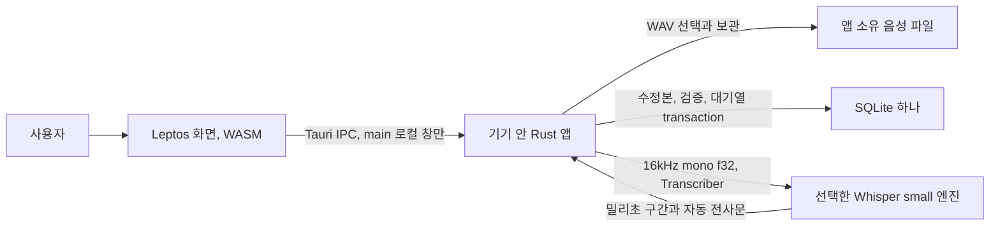

# seamone
기기 안에서 WAV를 받아쓰고, 음성과 글을 함께 확인하며 수정하는 Rust 앱이다. macOS, Windows, Linux, Android, iOS 설치 파일을 GitHub Actions에서 만든다. 실제 Whisper small 받아쓰기는 선택한 데스크톱 feature로 켠다.

## 1. 사용하는 흐름
1. `WAV 가져오기`에서 16kHz mono PCM16 WAV를 고른다, 0초 초과 30분 이하만 받으며 앱 보관함에 원본과 별도로 복사한다
2. Whisper 엔진이 포함된 설치본에서 `Whisper 모델 선택`으로 공식 `ggml-small.bin`을 고른 뒤 `기기 안에서 받아쓰기`를 누른다, 앱이 모델을 내려받지 않는다
3. `자동 전사문 Yes/No 검증`에서 현재 조각을 끝까지 듣고 `1`(그대로 맞음) 또는 `2`(다름)를 누른다, 이 화면에는 글 입력란이 없다
4. `No와 수정본 확인 목록`에서 음성을 듣고 나온 말을 그대로 고친 뒤 `이대로 교정 확정`을 누른다, 중간에 멈추려면 `초안 저장`만 한다
5. 저장한 글은 검증 여부와 관계없이 복사하거나 텍스트 파일로 내보낸다

- 검토 화면에서 `Space`는 재생, `N`은 판정 없이 다음 조각, `Esc`는 나가기다, binary 판정은 `1/2`, 교정 확정은 `Ctrl/Command+Enter`다, 버튼도 같은 동작을 한다
- 처음 No로 판정한 글은 앞뒤 공백만 바꿔 교정 확정할 수 없다, 원래 글이 맞았다면 `처음 판정 취소하고 다시 검수`로 돌아가 다시 듣고 Yes를 고른다
- 잘 안 들리거나 잘린 구간은 확인하지 않고 남긴다, 재생할 수 없는 첫 조각도 건너뛰어 다음 조각을 확인할 수 있다
- 음성이 끝나기 전이나 저장 중에는 판정하지 않는다, 저장이 실패하면 현재 조각에 남는다
- 일반 편집과 초안 저장은 정답을 만들지 않는다, 같은 글을 다시 저장하면 기존 검증을 유지한다
- 초안 저장으로 수정본이 바뀌면 다시 들어야 한다, 수정 목록에서 재생 후 편집하고 곧바로 확정하는 경우에는 한 번의 재생으로 충분하다
- 앱 내부 학습 엔진은 준비되지 않았다, 확인한 정답은 실제 로컬 대기열에 보관하며 학습 진행률을 표시하지 않는다
- 음성, 글, 검증 결과는 이 기기에 남는다, 외부 전송과 연합학습은 구현하지 않았다, 첫 실행 안내는 언제든 다시 연다

## 2. 구조

- `crates/seamone-core`: 음성 구간, 자동 전사문, 수정본, 실제 Yes/No 판정, 정답 snapshot, 학습 적격 조건과 검토 화면의 상태 전이, 화면과 native가 함께 쓴다
- `crates/seamone-asr`: 기존 `Transcriber` interface와 시험용 `FakeTranscriber`, `whisper` feature의 실제 엔진, 시험용 전사문은 제품 화면에 넣지 않는다
- `app/src-tauri`: native 파일 선택, WAV 보관, SQLite migration, 신뢰할 창과 command 권한, 받아쓰기, 검증 저장, 내보내기, 로컬 작업 경계
- `app/ui`: 두 검토 화면과 일반 편집, 현재 조각의 HTML audio `ended` event가 있어야 확인한다, session과 조각 ID와 revision으로 늦게 온 응답을 거절한다
- `research`: 앱과 별도인 PyTorch 연구 코드, 앱은 Python을 포함하지 않고 연구 adapter를 활성화하지 않는다

### 2-1. 데이터와 저장
- native가 앱 데이터 폴더의 `seamone.sqlite3`와 `audio/<UUID>.wav`를 소유한다, 화면에서 임의 파일 경로를 넘겨 읽을 수 없다
- 녹음마다 엔진과 모델 metadata를 보관한다, 자동 전사문과 사용자가 편집한 글은 별도 칸이다
- `Transcriber`의 밀리초 구간을 native 경계에서 checked 정수 표본 번호로 바꾸고 원본 길이 안으로 제한한다, 원래 interface는 유지한다
- 재생은 파일에서 해당 구간만 seek해 읽는다, 시작을 포함하고 끝을 제외하는 최대 60초 WAV를 만들어 제한된 IPC 응답으로 보낸다
- 조각 목록은 한 응답에 최대 32개, 각 글은 최대 32KB, 녹음 전체의 편집 글은 최대 2MB다
- 검증 요청은 event ID, 조각 ID, 정확한 revision, 동작을 담는다, 같은 event의 재전송은 같은 결과를 돌려주며 다른 내용이나 오래된 revision은 오류다
- 변경은 짧은 SQLite transaction에서 revision을 비교한 뒤 저장한다, 정답 snapshot과 대기열도 함께 저장해 일부만 남지 않는다
- 자동 글을 그대로 맞다고 한 정답과 수정 후 확인한 정답은 출처를 구분한다, 편집이나 검증 취소는 그 수정본의 정답과 대기열을 무효화한다
- 학습 시작과 결과 공개 직전에 현재 수정본, 녹음 revision, 원본 존재와 SHA-256을 다시 검사한다, 원본 읽기 실패는 복구 뒤 재시도하며 바뀐 수정본은 제외한다
- 대기열 claim은 소유자와 5분 lease를 사용한다, 보관함을 다른 연결로 열었다는 이유로 진행 중인 claim을 되돌리지 않는다, 만료한 claim만 회복한다
- native optimizer를 연결할 경계는 있지만 현재 설치본은 대기열을 처리하지 않는다, 모델 activation과 네트워크 FL도 하지 않는다

## 3. 실행과 검증
### 3-1. 준비
- `rustup`을 설치한 뒤 레포 맨 위에서 `make install`을 실행한다, `rust-toolchain.toml`의 Rust와 고정한 tauri-cli, Trunk를 설치한다
- 로컬 데스크톱 실행에는 해당 OS의 Tauri 개발 환경이 필요하다, 설치 파일은 로컬에서 만들지 않는다
- 기본 실행은 `make dev`다, 기본 feature에는 실제 ASR 엔진이 없으므로 받아쓰기 버튼이 엔진을 포함한 설치본을 안내한다

### 3-2. offline Whisper small
공식 모델은 [고정한 whisper.cpp 모델 저장소](https://huggingface.co/ggerganov/whisper.cpp/tree/80da2d8bfee42b0e836fc3a9890373e5defc00a6)의 `ggml-small.bin`이다.
- SHA-256은 `1be3a9b2063867b937e64e2ec7483364a79917e157fa98c5d94b5c1fffea987b`다, 선택할 때와 엔진이 불러올 때 확인한다
- 모델은 별도로 준비해 파일 선택 대화상자에서 지정한다, 모델이 없거나 다르면 앱이 고칠 방법을 안내하며 시작할 때 내려받지 않는다
- 실제 데스크톱 엔진 실행 명령은 `make dev CARGO_FEATURES=desktop-whisper`다, 현재 엔진은 CPU 경로를 쓴다
- macOS Command Line Tools에서 C++ `<array>` header를 찾지 못하면 설치된 SDK의 header를 이 명령에만 지정한다
```sh
CXXFLAGS="-isystem $(xcrun --sdk macosx --show-sdk-path)/usr/include/c++/v1" make dev CARGO_FEATURES=desktop-whisper
```
- 모델 파일은 가져온 음성과 별도다, 이 연구의 PyTorch LoRA adapter는 GGML 엔진에서 불러오지 않는다

### 3-3. 시험 범위
- `make lint`: Rust 서식, native와 WASM clippy, UI 시험 JavaScript의 구문을 검사한다
- `make test`: domain, 실제 SQLite, 검토 상태 전이와 Tauri mock runtime의 등록 IPC를 확인한다, OS 파일 선택 대화상자를 조작하는 시험은 아니다
- `make ui-test`: 실제 WASM 화면을 Chrome에서 돌리고 HTML audio의 실제 `ended` event, 키보드, 버튼과 오류 흐름을 확인한다, IPC 서비스는 시험용이다
- `make desktop-proof`: 실제 Whisper small과 canonical WAV를 사용해 native 가져오기, 받아쓰기, 구간 WAV, 검증, eligibility와 재실행을 확인한다, 사람의 검토 event는 시험이 흉내 내며 해당 음성을 학습에 쓰지 않는다
- `make -C research test`: 연구 규칙과 optimizer 계산의 회귀시험, 실제 모델 optimizer 증명은 별도 `verified-step` target이다
- `make fmt`와 `make -C research fmt`: 소스 형식을 맞춘다

UI 시험 의존성은 시험 폴더에만 설치한다, 기존 Chrome을 사용하면 브라우저를 따로 내려받지 않는다.
```sh
npm ci --prefix app/ui/tests --ignore-scripts --no-audit --no-fund
SEAMONE_CHROME="/Applications/Google Chrome.app/Contents/MacOS/Google Chrome" make ui-test
```
Linux에서는 `SEAMONE_CHROME="$(command -v google-chrome)" make ui-test`를 쓴다.

실제 native 모델 시험은 준비한 파일 경로를 지정한다.
```sh
SEAMONE_WHISPER_MODEL=/path/to/ggml-small.bin SEAMONE_TEST_WAV=/path/to/public-ko.wav make desktop-proof
```
macOS에서 위 C++ header 오류가 나면 같은 `CXXFLAGS`를 이 명령에도 지정한다. `CARGO_TARGET_DIR`을 지정하면 각 make target이 같은 Cargo cache를 쓴다.

### 3-4. CI 설치 파일
- `.github/workflows/ci.yml`은 `make lint`, `make test`, `make ui-test`, `make -C research test`를 실행한다, UI 시험은 runner에 설치된 Chrome/Chromium을 찾고 없으면 실패한다
- `.github/workflows/build.yml`은 macOS arm64와 x86_64 dmg, Windows exe와 msi, Linux deb와 AppImage, Android debug apk, iOS simulator app을 만든다
- 기본 다섯 플랫폼 빌드는 유지한다, Actions의 build를 수동 실행할 때 `desktop-whisper`를 선택하면 데스크톱 설치본에만 실제 엔진을 포함한다, 모델 파일은 포함하지 않는다
- Whisper를 포함한 macOS 설치본만 macOS 11.0 이상을 요구한다, CI가 전용 config를 병합하면 Tauri CLI가 컴파일 deployment target과 bundle 최소 version에 함께 적용한다
- desktop의 `make build`와 모바일의 기존 Tauri build 명령은 CI에서만 실행한다, 서명과 앱 장터 배포는 포함하지 않는다
- Actions 실행의 Artifacts에서 설치 파일을 받는다, Android 시험용 debug 키는 `.github/android/debug.keystore`로 고정한다
- macOS와 Windows 설치 파일은 인증서로 서명하지 않았다, macOS는 `xattr -dr com.apple.quarantine seamone.app` 뒤에 열고 Windows는 SmartScreen의 추가 정보, 실행을 누른다
- Linux AppImage는 실행 권한을 준 뒤 연다, Android는 시험용 debug 서명 APK이며 iOS는 시뮬레이터용이다

## 4. 라이선스
Apache-2.0, 모델과 공개 corpus의 이용 조건은 각각의 배포처에서 확인한다.
