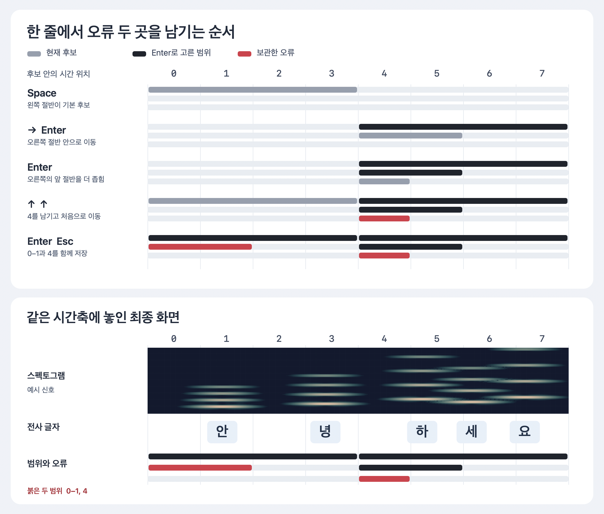

# 빠른 검수에서 한 줄의 오류 여러 곳 찾기

Seamone에서 녹음을 들으면서 오류를 발견하면, 음성과 전사를 같은 시간축에서 보고 오류 위치를 좁힌다. 한 번의 탐색에서 같은 전사 줄의 서로 다른 오류를 여러 곳 남길 수 있다. 이 문서의 화면은 동작을 설명하는 설계 예시다.

## 1. 키와 화면 상태

- 재생 중 `Space`를 누르면 방금 들은 구간을 잡고 재생을 멈춘다. 처음에는 왼쪽 절반을 회색으로 표시한다
- `←`와 `→`는 현재 단계에서 어느 쪽을 좁힐지 고른다. `Enter`를 누르면 그쪽을 검은색으로 확정하고 그 안을 다시 반으로 나눈다. 새 단계에서는 왼쪽 절반을 회색으로 표시한다
- `↑`는 현재 갈래에서 가장 좁혀 둔 후보를 빨간색으로 보관하고 한 단계 올라간다. 같은 갈래를 여러 단계 올라가도 이미 좁힌 빨간 범위를 넓히지 않는다. 올라간 단계는 왼쪽 절반부터 다시 고를 수 있다
- `Backspace`는 현재 회색 후보를 버리고 한 단계 올라간다. 다른 갈래에서 보관한 빨간 범위는 남는다. 최상위에서 누르면 현재 후보를 취소하며 보관한 범위가 없으면 재생으로 돌아간다
- `Esc`는 탐색을 끝낸다. 좌우 키로 직접 고른 후보나 Enter로 내려간 단계의 회색 후보를 보관한 범위에 추가해서 함께 저장한다. 최상위에서 기본으로 보이는 왼쪽 절반은 직접 고르거나 그 안으로 들어갔을 때 저장할 수 있다. 저장할 범위가 없으면 그대로 재생으로 돌아간다
- 저장을 마치면 처음 오류를 표시한 위치부터 재생을 이어간다. 저장이 실패하면 `Esc`로 같은 요청을 다시 시도하거나 `Backspace`로 그 요청을 접고 탐색으로 돌아간다
- 범위는 필요한 만큼 좁힐 수 있다. 각 절반을 최소 0.25초씩 들을 수 없는 길이에 이르면 현재 범위를 표시한다. 처음부터 짧은 후보는 `Enter`로 전체를 고른 뒤 `Esc`로 저장할 수 있다

회색은 현재 고를 수 있는 범위, 검은색은 `Enter`로 내려온 범위, 빨간색은 오류로 남긴 범위를 뜻한다. 빨간 범위는 `Esc`로 마칠 때까지 화면에 남는다.

## 2. 두 오류를 남기는 예

1. `Space`를 누른다. 후보 전체가 `0`부터 `7`까지라면 왼쪽의 `0–3`이 회색이다
2. `→`와 `Enter`를 누른다. `4–7`이 검게 바뀌고 그 안의 `4–5`가 회색으로 뜬다
3. `Enter`를 한 번 더 누른다. `4–5`가 검게 바뀌고 `4`가 회색으로 뜬다
4. `↑`를 두 번 누른다. `4`가 빨갛게 남고, 최상위로 돌아와 `0–3`이 회색으로 뜬다
5. `Enter`로 `0–3` 안에 들어가면 `0–1`이 회색으로 뜬다. `Esc`를 눌러 `0–1`과 `4`를 함께 저장한다

그림의 여덟 칸은 설명을 위해 나눈 시간 범위다. 실제 화면은 사용자가 고른 범위를 단계마다 나누고 그때마다 원본 녹음의 시각을 표시한다.

## 3. 음성, 전사, 오류 범위의 시간축

위에서부터 스펙트로그램, 전사 글자, 깊이별 오류 표시를 같은 너비로 놓는다. 위아래로 같은 위치는 원본 녹음의 같은 시각을 가리킨다. 예를 들어 시각 `4`의 오류를 볼 때 그 위치에서 해당 음성의 주파수 성분과 전사 글자를 함께 볼 수 있다.

- 스펙트로그램은 원본 음성의 시간과 주파수에 따른 세기를 보여 준다
- 전사 글자는 받아쓰기 엔진이 음성과 연결한 시각에 붙인다. 여러 글자를 엔진이 한 번에 반환하면 해당 글자들이 같은 시간 범위를 쓴다. 글자별 시간이 없는 기존 전사와 사람이 편집한 문장은 줄의 시작부터 끝까지 표시한다
- 막대는 듣던 범위, 각 단계에서 고른 절반, 보관한 오류 위치를 같은 시간축 위에 표시한다. 창 너비가 바뀌면 세 영역이 함께 조정된다
- 빨간 범위는 교정 목록에서 음성과 전사를 다시 확인할 때 쓰는 위치다. 학습 대기열에는 전체 음성과 대조해 교정을 명시적으로 확인한 전사 버전이 들어간다
